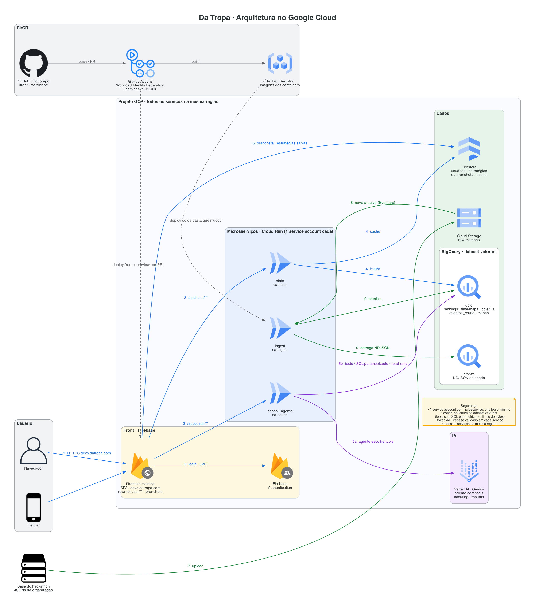

# Da Tropa

Analytics de partidas de VALORANT de campeonatos universitários, com coach de IA e prancheta tática. Primeira versão em `devs.datropa.com`.

Projeto para o [Hackathon SEMCOMP/VALORANT da USP São Carlos](https://docs.google.com/document/d/17dyxuHI6OXzETZ2VGsu1YTDowLzNzjjPGEKr2RC4qWc/edit), de 19 a 23 de outubro de 2026. A base são as partidas do UNIVAVÁ (classificatórias e fase de grupos) e da Rush Series, fornecidas pela organização.



## O que tem

- **Estatísticas:** ranking de jogadores, desempenho por time, mapa e agente, detalhe de cada partida.
- **Análise coletiva:** economia por round, pós-plant, retake, composições de agentes.
- **Coach de IA:** pergunta em português, resposta com dado de verdade. Um agente no Gemini escolhe tools com consultas prontas no BigQuery e explica o resultado. Também faz scouting de time e resumo de partida.
- **Prancheta tática:** minimapa 2D com agentes, desenho e etapas, link para compartilhar e replay 2D de qualquer round da base.

## Time

| Quem | Frente |
|---|---|
| Guilherme | Admin do GCP e do GitHub, infra, DevOps, coach e ingest |
| chico | Tabelas gold no BigQuery |
| gugu | API de estatísticas |
| Lhobregat | Front: prancheta tática e mapa de calor |
| RhuanK | Front: páginas, gráficos e tela do coach |

## Documentação

| Arquivo | Conteúdo |
|---|---|
| [docs/plano-de-acao.md](docs/plano-de-acao.md) | Quem faz o quê até quarta, cronograma e riscos |
| [docs/hackathon.md](docs/hackathon.md) | Regras do hackathon, entrega, critérios e prazos |
| [AGENTS.md](AGENTS.md) | Regras do projeto e do hackathon, donos das pastas, segurança. Vale para pessoas e agentes de IA |
| [docs/arquitetura/README.md](docs/arquitetura/README.md) | Componentes, fluxos, tools do coach, prancheta, decisões |
| [docs/dados.md](docs/dados.md) | A base de partidas: onde baixar, formato do JSON, armadilhas |

## Estrutura

```
front/                      SPA no Firebase Hosting
services/stats/             estatísticas e análise coletiva
services/stats/sql/gold/    SQL das tabelas gold
services/coach/             coach de IA
services/ingest/            carga dos JSONs no BigQuery
infra/                      configuração de GCP e Firebase
docs/                       plano, arquitetura e dados
```

## Stack

Google Cloud: Firebase Hosting, Authentication e Firestore, Cloud Run, BigQuery, Cloud Storage, Eventarc, Vertex AI (Gemini). CI/CD no GitHub Actions com Workload Identity Federation.
