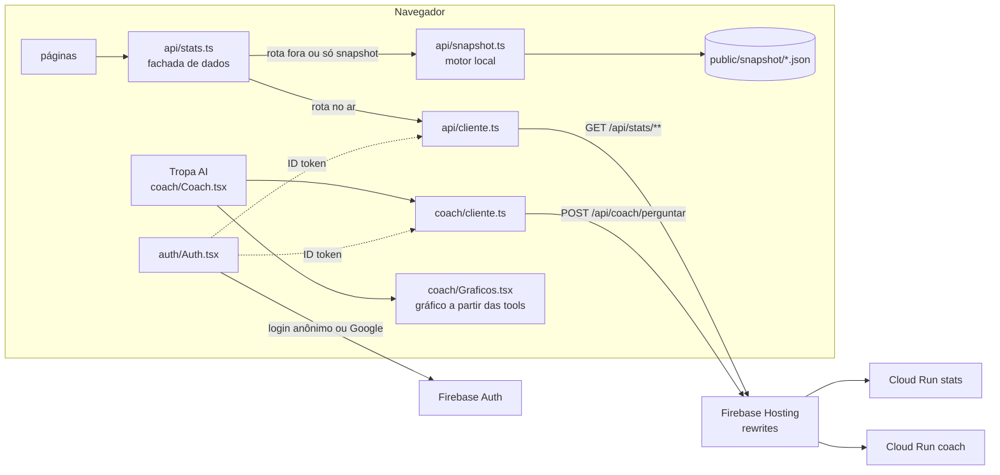

# Arquitetura do front

## Camadas

1. **Páginas** (`src/paginas`) só montam a tela. Pedem dados com `useDados(chave, () => dados.algo())` e mostram carregando, erro e vazio com os componentes de `componentes/Visuais.tsx`.
2. **Fachada** (`src/api/stats.ts`). Uma função por rota do contrato (`docs/api.md`) mais as que ainda só existem no snapshot (`series`, `panorama`, `metaCena`).
3. **Cliente** (`src/api/cliente.ts`). Envelope `{data, meta}`/`{data, pagination, meta}`, erros `{error: {code, message}}`, `Retry-After`, timeout de 8 s.
4. **Snapshot** (`src/api/snapshot.ts`). Lê as tabelas de `public/snapshot` e calcula as mesmas respostas do contrato, com as regras da gold.
5. **Cache** (`src/api/useDados.ts`). Memória, 5 minutos, chamadas iguais deduplicadas.

## API real ou snapshot

`VITE_FONTE_DADOS=auto` (padrão):

- tenta `/api/stats/...`;
- se a resposta não é JSON (o Hosting devolve o `index.html` quando o serviço não existe), se a rede falha, se dá timeout, 5xx, 404 sem `NOT_FOUND` ou 400 (parâmetro que a API ainda não aceita), usa o snapshot;
- uma rota que falhou por falta de API não é tentada de novo na mesma sessão;
- 404 `NOT_FOUND` de verdade sobe para a tela ("não encontramos isso na base").

Cada resposta leva `meta.fonte` (`api` ou `snapshot`), e as telas mostram a origem no rodapé (`FonteDados`).

Os IDs do snapshot são os mesmos da gold (ver [dados.md](dados.md)), então as duas fontes podem se misturar na mesma tela.

## Roteamento

`src/rotas.tsx`: History API, `<Link para>`, `useLocal()`, `useParametro()` para filtros na URL (`?torneio=`, `?mapa=`, `?agente=`). O Hosting já reescreve tudo para o `index.html`.

## Tropa AI

- `CoachProvider` guarda a conversa (sessionStorage), abre e fecha (orbe do header, Ctrl/Cmd+K, Esc) e envia.
- O histórico vai em texto, até 20 turnos, como o coach pede (`services/coach/README.md`).
- A tela atual registra contexto com `useContextoCoach` (partida, time ou jogador). A pergunta vai com o prefixo `[Contexto da tela: partida <id> (...)]`, para o agente usar os IDs nas tools. O chip "VOU CONSIDERAR" desliga isso.
- Erros: 401 pede para recarregar, 429 mostra a mensagem do coach (limite de perguntas) ou o tempo de espera, 400 pede para reescrever, 503 e rede mostram "tente de novo".

### Gráficos nas respostas

O gráfico sai do resultado das tools (`data.tools[].resultado`), no front, de forma determinística. Os números do gráfico são os mesmos que o modelo leu.

| Tool | Gráfico |
|---|---|
| `economia_time` | Barras por compra com a média da cena |
| `pos_plant_retake` | Dois anéis (pós-plant e defesa após plant) e barras por mapa |
| `comparar_times` | Barras espelhadas A × B |
| `resumo_partida` | Momentum do placar e livro de rounds, com link de cada round para a prancheta |
| `stats_time`, `stats_jogador` | Colunas de vitória por mapa e barras de agentes |
| `scouting_time` | As duas acima juntas |
| `abrir_na_prancheta` | Cartão com o botão "Ver o round N na prancheta" |

Tool nova com lista de taxas pode ganhar gráfico em `coach/Graficos.tsx` (`POR_TOOL`).

## Gráficos

Próprios, em SVG e HTML (`src/graficos`). Formatos: barras contra a média, barras espelhadas, momentum, livro de rounds, anel, colunas e economia round a round. Todos têm dica no hover, foco por teclado e tabela equivalente pela `<Figura>`. Sem biblioteca: os formatos são poucos, a identidade é fixa e o bundle fica pequeno.

As cores da marca (âmbar e menta) passam no teste de daltonismo (ΔE 15 entre elas) e de contraste com o fundo. São claras para a faixa recomendada no tema escuro, por isso todo gráfico tem legenda, rótulo direto ou tabela: a cor nunca é a única pista.

## Auth

`auth/Auth.tsx` carrega o SDK do Firebase sob demanda. Config: `/__/firebase/init.json` no Hosting ou `VITE_FIREBASE_*`. Ao abrir a Tropa AI sem usuário, entra sozinho como anônimo (`signInAnonymously`), sem tela de login; o Google em popup fica no avatar do header. O token vai para o coach e, quando há usuário, também para o stats.
